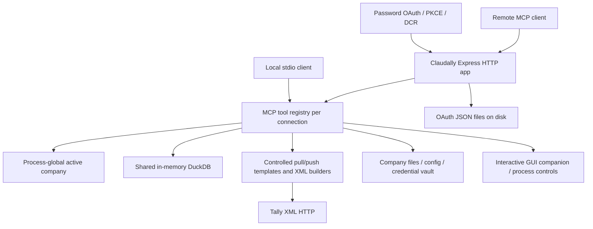
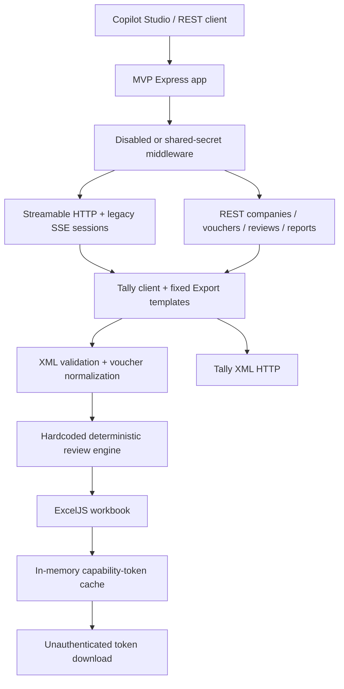

# As-is architecture

Source-verified on 2026-11-23; live deployment unverified. See [comparison](REPO_COMPARISON.md) for exact repository identities.

This file describes existing implementations. The selected future direction is [modular Claudally with a Tally Review profile](MODULAR_CLAUDALLY_PLAN.md); those proposed modules are not yet implemented.

Claudally HTTP authenticates a token on POST/GET/DELETE `/mcp` but does not bind the transport ID to that token's client or a user. OAuth records contain token/client/expiry, not Entra tenant/employee/company claims. All tool registries import module-global state. DuckDB uses one connection and random table names with expiry, without an owner policy. SELECT filtering and disabling external access reduce filesystem risk but do not provide company isolation or resource budgets.

XML requests use UTF-16LE and configured host/port, a 30-second socket timeout and selected preflight pings. Socket inactivity timeout is not an absolute wall-clock deadline. Pull definitions drive field conversion and templates; rendering includes injection defenses. Voucher/master modules handle writes, balancing, identifiers, names and idempotency. They are outside this pilot. Company loading also reaches filesystem/process/GUI operations; Windows Session 0 cannot substitute for the interactive companion's desktop session.

Public HTTP surface in source: `/mcp`; `/.well-known/oauth-protected-resource` and its `/mcp` suffix; `/.well-known/oauth-authorization-server`; `/authorize` GET/POST; `/token` POST; `/register` POST; `/status` GET when enabled. Status has no auth middleware and can reveal operational/company details. Proxy routing must not expose it by default.

MVP liveness and OpenAPI are public. MCP aliases are `/mcp`, `/sse`, `/mcp/sse`; legacy posts use `/messages` and `/mcp/messages`. POST initialize constructs a Streamable transport; GET without an existing Streamable session starts legacy SSE even on `/mcp`. Sessions are maps without identity ownership or expiration budgets. Existing-session GET is routed before legacy fallback and is exempted from authentication by middleware.

MVP XML uses UTF-8, HTTP status checks, a default 15-second AbortSignal and empty-response rejection. Company XML and Day Book XML are fixed templates, not LLM-authored. The normalizer validates XML syntax, handles STATUS=0, finds voucher nodes, preserves signed amounts and debit/credit flags, resolves GUID/master/composite IDs, and filters dates. Unexpected valid XML can become an empty list; numeric parsing is permissive. See [security review](../security/SECURITY_REVIEW.md).

Review rules match narration keywords to five expected ledgers. A small hardcoded bank/cash set is excluded; other lines all receive the same matched rule. Period/type anomaly messages are advisory heuristics. Runtime code does not load the reference Word/Excel documents. Excel generation sanitizes text and includes evidence, original voucher details and a summary. Cache tokens are random UUIDs, default TTL one hour, cleanup every ten minutes, with no byte/owner limit. Restart loses reports and sessions.

Historical `ConnectorOperationNotFound` belongs to the earlier connector path. The user reports the later MVP works with Copilot; current code confirms both MCP and REST implementations exist but cannot identify which deployed connection produced that success. Preserve the working connection until a separately staged MCP migration passes.
