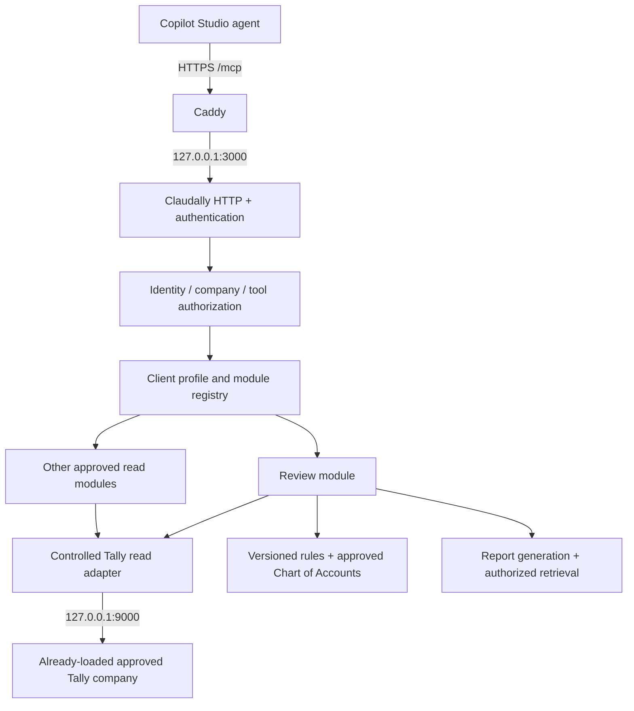

# Modular Claudally implementation plan

Updated 2026-11-23 following the user's choice of Claudally as the foundation. This is the current implementation direction and supersedes the earlier recommendation to build on the separate MVP. Scope of this task: planning/documentation only. Nothing described below is claimed implemented or tested.

## 1. One application, configurable client profiles

Develop in this repository. Produce one versioned MCP application release, with an administrator-controlled profile for each deployment. Caddy runs alongside it as a separate reverse-proxy service. The old MVP is a reference for review behavior and regression cases, not a second running backend or runtime dependency. Preserve its working connection until replacement UAT passes.



Initially use a separate service deployment/configuration per client on that client's approved host. Do not introduce shared multi-client hosting for the pilot. One maintained codebase does not mean one shared process or shared client data. Multiple finance users within a deployment still need backend authorization and isolation.

Claudally already supplies Streamable HTTP, OAuth/PKCE mechanics, auth rate limiting, Host/CORS checks, Tally report templates and many regression tests. Those are useful foundations, not proof the whole application is enterprise-secure. Global company/cache state, broad operational tools, secret persistence, audit payloads and missing employee permissions remain gaps documented in the [security review](../security/SECURITY_REVIEW.md).

## 2. First profile: Tally Review Agent

| Module | First client profile | Behavior |
|---|---|---|
| Core transport and policy | Required | Authenticate requests; enforce configuration, company/tool permissions and limits |
| Company reads | Enabled | Return only authorized, already-loaded companies; no discovery of arbitrary disk folders |
| Day Book reads | Enabled | Retrieve the approved company's vouchers for a validated, bounded period |
| Accounting review | Enabled | Evaluate versioned rules and COA; return Correct, Incorrect or Needs Review with evidence |
| Review reports | Enabled | Generate an audit-supporting Excel report; authorize retrieval and expire it |
| Ledger/financial/GST/inventory reports | Disabled initially | Future modules enabled only when requested, tested and authorized |
| Arbitrary SQL, raw XML, GUI, company loading/restart, financial writes | Prohibited in review release | No tool registration, reachable handler or indirect service path |

Conceptual configuration, not an existing supported configuration format:

```json
{
  "profile": "tally-review",
  "modules": ["company-read", "daybook-read", "review", "review-report"],
  "allowedCompanies": ["APPROVED_SANDBOX_COMPANY"],
  "ruleSetId": "finance-approved-v1",
  "chartOfAccountsId": "approved-company-coa-v1",
  "readOnly": true
}
```

The company list above is a deployment ceiling; each authenticated principal can have a narrower policy. Secrets are separate. No model or Copilot tool can alter this configuration. Initial configuration changes require an administrator, validation and controlled restart; a management UI is unnecessary for the first release. Unknown modules, missing dependencies, invalid policy and prohibited combinations fail startup. Default is deny, never enable every upstream tool.

## 3. Refactor tool registration safely

Current [mcp.mts](../../src/mcp.mts) registers a large tool surface and imports database, process/GUI and write-related functionality. Adding a tools/list filter alone is insufficient.

Proposed new layout, all within this repository (paths below are planned, not existing):

```text
src/
  core/                 # validated config, identity, policy, registry, audit, budgets
  tally/                # bounded transport, company-scoped read adapter, normalization
  modules/
    company-read/
    daybook-read/
    review/             # rules, COA mappings, findings and evidence
    review-report/      # workbook generation and authorized retrieval
    financial-reports/  # later
    gst-reports/        # later
  profiles/             # configuration schemas and safe sample profiles
tests/
  fixtures/             # synthetic company, Day Book and COA data
  integration/          # real MCP protocol with fake Tally only
```

Retain/refactor [server.mts](../../src/server.mts) and [http-app.mts](../../src/http-app.mts) as entrypoints. Extract module registrations incrementally, preserving relevant upstream tests. Modules declare their tool names, dependencies and required permissions. The registry exposes only enabled/authorized tools and wrappers check policy again on every call. Tool arguments cannot override module enablement, identity or allowed company.

Pass a request context containing validated principal, explicit company, request ID and budget. Replace process-global active-company selection in the review path. Do not let core startup import disabled GUI/write modules or initialize shared DuckDB merely because upstream did so. Initially omit SQL and table caching from review execution; report summaries should be computed by deterministic code. Test direct calls to disabled tool names and internal paths as well as tool discovery.

No need to delete every upstream feature in one change. Keep unrelated upstream source separate and unreachable from the review runtime. Future write features require a new scope/security design and explicit approval; they are not client-configurable options in this review release.

## 4. Implement the actual review workflow

The existing generic reports do not supply the full requested Tally Review Agent. Add the domain behavior inside this application, retaining the useful MVP rules/report behavior through regression cases. Do not import its permissive HTTP middleware or legacy transport. Resolve code ownership/licensing before porting implementation; preserve the existing AGPL/NOTICE terms and record provenance. Client distribution/source-availability arrangements must be settled before release; choosing Claudally is not legal sign-off.

1. **Retrieve Day Book:** user selects an authorized company and date range. Use a fixed reviewed Export template; validate dates, enforce workload/response bounds and confirm the company. Return explicit failures for closed companies, invalid envelopes, errors or incomplete results.
2. **Normalize:** preserve company-qualified voucher ID/revision, date, type, ledger lines, signed money, currency and narration. Strictly parse amounts; missing or invalid values must not silently become zero. Distinguish legitimate empty periods from failures.
3. **Load approved rules/COA:** administrators convert accounting rules into a structured, versioned rule set and validate it with finance. Import an approved COA through a defined column schema with duplicate/missing-field checks and company binding. Record source/version/hash and approval. Do not ask an LLM to reinterpret a Word document during every review. Live Tally COA reconciliation can check ledger existence; disagreement with the approved COA is an exception, not automatic overwrite.
4. **Evaluate deterministically:** preserve the five existing category rules as a baseline. Handle tax/settlement entries, aliases, multi-expense narration and ambiguous matches explicitly. Unknown or out-of-scope entries become Needs Review; an incorrect classification proposes a ledger but never changes it. Confirm suggestions exist in the approved COA. Finance approves coverage and exception rules.
5. **Produce evidence:** include voucher/line identity, current ledger, classification, reason, suggested ledger if justified, rule/COA versions and human-review requirement. Correct means the supported checks passed, not that every accounting/audit assertion is certified.
6. **Generate report:** summary, findings and original voucher evidence; company/range, generation time, source completeness/counts, rules/COA versions and limitations. Sanitize spreadsheet text. Reports are owner/company scoped, bounded and time-limited; no publicly reusable download token. Decide browser login/download UX during staging.

The primary pilot input is a live read-only Day Book export retrieved through Tally XML. Synthetic exports exercise the same parser in local tests. An uploaded-export workflow is a separate optional input adapter; file format, upload validation and delivery path must be specified before promising it. Both should feed the same normalization/review engine when supported.

Proposed Copilot-facing tools: list_tally_companies, search_day_book, review_vouchers and check_api_health, preserving familiar MVP names where schemas match. Report retrieval may use an additional authorized endpoint/tool; it is not assumed to inherit a browser user's authentication from Copilot. For larger approved periods, consider bounded asynchronous review jobs if measured latency exceeds Copilot limits; do not promise an untested synchronous large export.

## 5. Authentication and Caddy

Caddy provides the public HTTPS endpoint/certificate and forwards approved routes. Claudally handles authentication and authorization; Caddy does not add employee identity or modules.

Two explicit auth milestones:

- **Compatibility proof with synthetic data:** exercise existing Claudally OAuth/PKCE through a separately approved staging Copilot connection. Test discovery/registration or manual registration, code exchange/refresh and all MCP methods. This establishes protocol compatibility only; shared-password OAuth does not identify individual finance users. Harden token storage and bind sessions to the authenticated connection. Do not silently fall back to no auth if discovery fails.
- **Enterprise acceptance:** add an Entra-backed authentication adapter in this repository, or another explicitly approved employee-identity solution. Validate tenant/issuer/audience/signature/expiry/scopes and map the verified identity to companies/tools. Test the actual Copilot connection ownership/channel semantics. Shared connection identity must not be represented as an employee. No parallel MVP service is needed for either adapter.

Session ownership must survive legitimate token refresh but reject other principals. Enforce authentication for POST/GET/DELETE, report ownership, fixed public URL/trusted proxy settings, bounded sessions/queries/reports and minimal redacted audit events. Stop logging arbitrary tool arguments. READONLY_MODE remains defense in depth, not the module authorization mechanism.

Caddy's exact public routes depend on auth mode. Existing Claudally OAuth needs its authorization/token/registration and discovery routes; an external IdP changes that routing contract. Do not expose `/status`, root, debug or unrelated routes wholesale. Keep MCP/Tally loopback ports private. Verify streaming, session/auth headers and certificate renewal. These changes are staged and approval-gated.

## 6. Ordered delivery plan and acceptance gates

| Step | Deliverable | Done when |
|---|---|---|
| 1: Baseline and configuration isolation | Pin reviewed commit/dependencies; record existing tests; isolate real .env; fake-Tally harness; confirm legal/provenance path | Build/test environment cannot contact real Tally, launch GUI or touch live configuration |
| 2: Module/profile foundation | Strict profile schema, registry, request context, read-only runtime and first company-read tool | Only profile-approved tools appear; direct disabled calls fail; no disabled module side effects |
| 3: Protocol/auth spike | Existing OAuth + complete Streamable handshake with fake data; staged Copilot proof after approval | Initialize/list/call/refresh work; invalid tokens and another connection's session fail |
| 4: Review domain | Day Book adapter, strict normalization, approved rule/COA ingestion, classifications and Excel output | Finance golden fixtures pass; malformed values/error/empty cases distinguish correctly; reports carry evidence/versioning |
| 5: Enterprise security | Principal/company policy, employee auth adapter, private reports, quotas, sanitized audit and shutdown | Two-user/company isolation, expired/revoked token tests, spoofing/injection and resource-bound tests pass |
| 6: Windows + Caddy staging | Pinned Windows service packaging, least-privilege accounts, approved HTTPS routing and recovery | Loopback binds/ACLs, service restart/stop, certificate renewal and Tally logoff/reboot behavior verified |
| 7: Real Copilot + sandbox UAT | Separate test connection invokes each allowed tool against approved sanitized company | Finance reconciles company/range/counts/signed totals and sampled findings; unauthorized tools/company/report access fail |
| 8: Restricted production pilot | Approved release, change window, backup/rollback, monitoring and named IT/finance sign-off | Low-volume read-only tests pass; no outstanding P0; documented rollback and support ownership |

Steps 2–5 are local application development, with any tenant/network tests separately authorized. Exact timelines depend on identity/COA decisions and staging access. Establish small reviewable changes per step rather than a single rewrite. Do not run the current full suite with real .env loaded or start existing dev scripts until isolation is proven.

Production approval covers specified service/account/network/DNS/TLS changes and read-only data scope. It does not authorize Tally writes, raw XML tools, GUI automation or company restarts. Stop on wrong-company access, financial mismatch, unexpected changes or Tally disruption. Refer to [prerequisites](../deployment/PREREQUISITES.md), [validation](../deployment/VALIDATION_PLAN.md) and [rollback](../deployment/ROLLBACK.md) for detailed gates.

## 7. Inputs needed before staging

- Approved nonproduction company/export fixtures, rules and COA version; finance reviewer and expected outcomes.
- Existing Copilot connection's protocol/auth mode and owner, supplied without secrets; whether the test instance is sandbox or live.
- Client tenant/company/role mapping and decision on employee versus explicitly scoped service identity.
- Approved test hostname, host/service account ownership, certificate/ingress method and change window.
- License/provenance decision and approved data/report/transcript retention.

These do not block writing the local module/configuration design. They do block claims of live compatibility, unrestricted port exposure or production readiness. All runtime acceptance results are currently UNVERIFIED.
