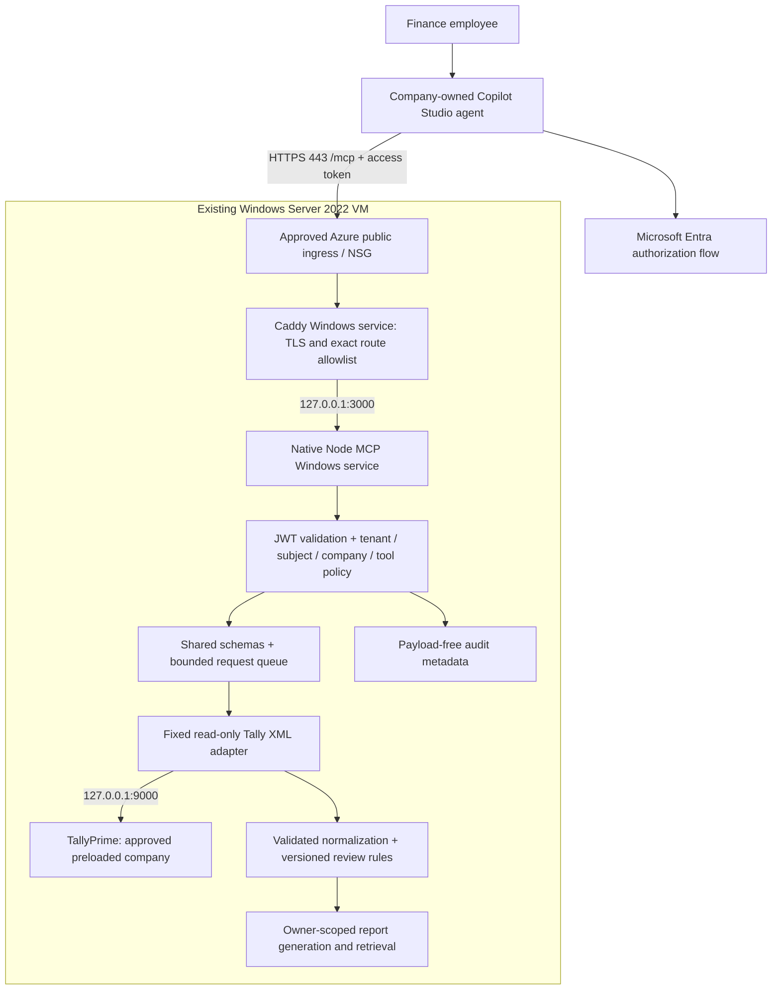

# Target architecture: proposed, not deployed

**Current foundation:** the user selected this Claudally repository, refactored into configurable modules, as the sole application codebase. See [MODULAR_CLAUDALLY_PLAN](MODULAR_CLAUDALLY_PLAN.md) for module boundaries and delivery steps. The trust boundaries and safeguards below still apply; they do not require a separate MVP backend.



Caddy provides TLS/routing, not OAuth authorization, company policy or a WAF. The backend validates issuer, tenant, audience, signature/key rotation, token validity and granted scope/role. Map the verified principal to an explicit company/tool allowlist. Caller-supplied company names are selectors, never authorization evidence. Do not accept user IDs supplied by the model as identity.

Use manual OAuth onboarding with an Entra app registration as the first design candidate. Its actual Copilot behavior and per-user connection semantics remain a validation gate. A shared/service connection identifies that connection, not necessarily the finance employee. If employee identity cannot be proven, either restrict the entire connection to an explicitly approved scope or block the employee-scoped pilot; never invent attribution. Do not implement a bespoke authorization server just to copy Claudally's password flow.

```mermaid
sequenceDiagram
  participant C as Copilot Studio
  participant P as Caddy
  participant M as MCP service
  participant T as TallyPrime
  C->>P: POST /mcp initialize with bearer token
  P->>M: Preserve MCP/auth headers and external Host
  M->>M: Validate identity; create subject-bound session
  M-->>C: Initialization result / session ID
  C->>P: initialized notification then tools/list
  P->>M: Forward request
  M-->>C: Authorized read-only tools
  C->>P: tools/call with company and dates
  P->>M: Forward request
  M->>M: Revalidate identity, session, tool, company and bounds
  M->>T: Fixed Export template for approved company
  T-->>M: XML response
  M->>M: Validate structure/company/completeness; normalize; review
  M-->>C: Bounded evidence + authorized report reference
```

Enforce authorization on every call, even if the tool was previously discovered. Bind sessions to stable tenant/subject/client context so token refresh works without allowing another user to take over. Limit session count, idle/absolute lifetime, concurrent queries, XML bytes, date window, output rows and report cache bytes. Prefer a serialized or conservatively bounded Tally request queue; size it from sanitized tests, not production load tests.

Use explicit company on every Tally query; no global active-company mutation and no fallback to whichever company is currently open. Verify response context with a controlled company query where necessary and fail on ambiguity. Separate valid zero-voucher results from failed/closed-company/malformed/truncated responses. Preserve source identifiers, signed exact monetary values and rule version in results. Treat narration as untrusted data, never instructions.

Reports require an owner/company check on each retrieval, with an approved browser authentication flow or narrowly scoped, short-lived download mechanism. A Copilot backend token does not automatically authenticate a user's browser click. Choose this UX in staging; disable unauthenticated downloads until resolved. Do not embed reusable API keys in URLs. Make financial payload retention, transcript exposure, memory dumps and logs part of the data-handling decision.

Package Node plus compiled application as a versioned Windows-native release under WinSW or NSSM with a dedicated least-privilege account. No Docker Desktop dependency, GUI companion, automatic company loading, broad directory scan or Tally restart. Running MCP as a service does not prove Tally remains available after RDP disconnect/logoff/reboot. That behavior is a mandatory host test.

Same-VM deployment is cost-conscious but shares CPU/RAM/disk and failure domain with finance. It provides neither high availability nor a managed WAF. IT must accept that trade-off. If public ingress is prohibited, direct Caddy ingress is BLOCKED pending an approved alternative and verified Copilot transport compatibility.
